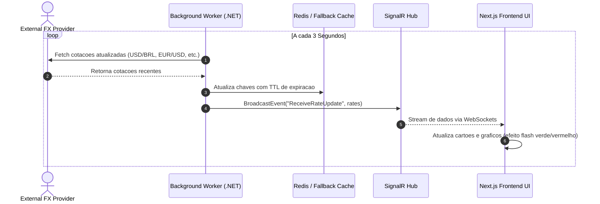

# 💱 Revolut FX Live Platform - Real-Time Foreign Exchange Engine


Uma plataforma de negociação e acompanhamento de câmbio de moedas internacionais em tempo real inspirada no **Revolut**. O sistema combina um backend **.NET 8 Web API** de altíssima performance, comunicação bidirecional em tempo real com **SignalR**, camada de cache híbrida **Redis / In-Memory Fallback**, e uma interface **Next.js 15** em estilo *Glassmorphism*.

---

## 🏛️ System Design & Arquitetura de Software

O sistema adota uma arquitetura orientada a eventos para streaming de dados em tempo real com tolerância a falhas.

```mermaid
flowchart TB
    subgraph Client ["Client Layer (Frontend)"]
        NextJS["Next.js 15 (React 19)\nUI Glassmorphic Vercel Style"]
        SignalRClient["SignalR WebSockets Client"]
        ChartUI["Recharts Interactive FX Chart"]
    end

    subgraph API ["Application Layer (.NET 8 Web API)"]
        Gateway["ASP.NET Core Controllers & Endpoints"]
        SignalRHub["CurrencyHub (SignalR WebSockets)"]
        BackgroundWorker["CurrencyBackgroundWorker\n(Polling a cada 3s)"]
        CurrencyService["CurrencyService\n(Calculadora & Conversão)"]
    end

    subgraph Caching ["Resilience & Cache Layer"]
        RedisCache["Redis Cache Server (6379)\n(High Frequency Rate Store)"]
        MemoryCache["In-Memory Cache (IMemoryCache)\n(Automatic Resilient Fallback)"]
    end

    subgraph External ["External Services"]
        AwesomeAPI["AwesomeAPI / External FX Rates API"]
    end

    AwesomeAPI -->|HTTP Polling (3s)| BackgroundWorker
    BackgroundWorker -->|Update Cache| RedisCache
    RedisCache -.->|Fallback on Disconnect| MemoryCache
    BackgroundWorker -->|Broadcast 'ReceiveRateUpdate'| SignalRHub
    SignalRHub -->|WebSocket Connection| SignalRClient
    SignalRClient --> NextJS
    NextJS --> ChartUI
    NextJS -->|REST API / Convert & Lock Rates| Gateway
    Gateway --> CurrencyService
    CurrencyService --> RedisCache
```

---

## ⚡ Principais Funcionalidades

- 🔴 **Live FX Rate Streaming:** Polling em background e transmissão contínua de cotações em tempo real via WebSockets (SignalR).
- 🛡️ **Resiliência Multi-Camada de Cache:**
  - **Redis Cache:** Armazenamento primário de alta velocidade para suportar alto volume de consultas simultâneas.
  - **In-Memory Fallback:** Troca transparente e automática para o cache local na memória do .NET caso o Redis fique offline.
- 🔒 **Garantia & Freeze de Taxa de Câmbio:** Congelamento da cotação por 30 segundos ao solicitar conversão para proteção contra volatilidade do mercado.
- 📊 **Gráficos Interativos & Ticker:** Histórico de variações de taxas em alta frequência com visualização gráfica interativa (`Recharts`).
- 💎 **Interface Premium Glassmorphic:** Design escuro moderno com transparências, cartões interativos e feedback visual imediato de altas e baixas das moedas.

---

## 🔁 Fluxo de Atualização de Cotação em Tempo Real



---

## 🛠️ Tecnologias Utilizadas

### Backend (.NET 8)
- **Framework:** ASP.NET Core Web API (.NET 8)
- **Real-Time Engine:** SignalR (WebSockets)
- **Caching & Caching Strategy:** StackExchange.Redis + `IMemoryCache` Fallback Strategy
- **Documentação API:** Swagger / OpenAPI
- **Background Tasks:** `IHostedService` (`CurrencyBackgroundWorker`)

### Frontend (Next.js 15)
- **Framework:** Next.js 15 (App Router, React 19)
- **WebSockets Client:** `@microsoft/signalr`
- **Data Visualization:** `Recharts`
- **UI Components & Icons:** TailwindCSS v4, Lucide React Icons

---

## 🚀 Como Executar o Projeto

### 1. Pré-requisitos
- [.NET 8 SDK](https://dotnet.microsoft.com/download/dotnet/8.0)
- [Node.js 18+](https://nodejs.org/)
- [Docker Desktop](https://www.docker.com/) (opcional, para executar o Redis)

---

### 2. Subir a Infraestrutura (Redis)

Você pode rodar o Redis rapidamente via Docker:

```bash
docker-compose up -d
```

> *Nota: Se o Docker/Redis não for iniciado, o backend utilizará automaticamente o **In-Memory Cache Fallback** sem interromper o funcionamento.*

---

### 3. Backend (.NET 8 Web API)

```bash
cd backend
dotnet restore
dotnet run
```

> O backend estará acessível em `http://localhost:5000` (Swagger disponível em `http://localhost:5000/swagger`).

---

### 4. Frontend (Next.js)

```bash
cd frontend
npm install
npm run dev
```

> A aplicação frontend abrirá em `http://localhost:3000`.

---

## 📊 Endpoints Principais da API REST

| Método | Rota | Descrição |
|---|---|---|
| `GET` | `/api/currency/rates` | Obtém todas as cotações ativas no cache |
| `POST` | `/api/currency/convert` | Executa a simulação de conversão com garantia de taxa |
| `GET` | `/api/currency/status` | Retorna o status de integridade da API e a conexão com o Redis |

---

## 📄 Licença

Este projeto está sob a licença MIT. Sinta-se livre para utilizar e aprimorar.
