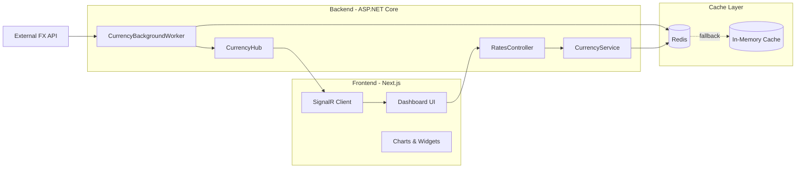

# 💱 Revolut FX Live Platform

<p align="center">
  
  
  
  
  
</p>

A modern FX dashboard inspired by Revolut, built with a .NET backend and a Next.js frontend for real-time currency tracking, live conversions, and market simulation.

## Overview

This project simulates a real-time foreign exchange platform where rates are polled periodically, cached, and pushed to the client through SignalR websockets. It includes:

- live FX rate streaming
- Redis caching with in-memory fallback
- simulated price conversion with a 30-second rate freeze
- interactive market charts
- real-time infrastructure status panel
- modern glassmorphism-style dashboard

## Architecture



## Main Features

- Real-time FX rates streaming every few seconds
- SignalR integration for instant frontend updates
- Redis-backed cache with resilient fallback logic
- Currency conversion with fee calculation and guaranteed rate lock for 30 seconds
- History and chart generation for multiple time windows
- Dashboard UI that mirrors a live trading/finance experience
- API health/status endpoint for infrastructure monitoring

## Tech Stack

### Backend
- .NET 8
- ASP.NET Core Web API
- SignalR
- Swagger / OpenAPI
- Redis via StackExchange.Redis
- Background hosted services

### Frontend
- Next.js 16
- React 19
- TypeScript
- Recharts
- Tailwind CSS
- Lucide icons

### Infrastructure
- Docker Compose
- Redis container
- Local development environment

## Repository Structure

```bash
.NET_pagamentos/
├── backend/
│   ├── Controllers/
│   ├── Hubs/
│   ├── Models/
│   ├── Services/
│   ├── Properties/
│   ├── Backend.csproj
│   ├── Program.cs
│   └── appsettings*.json
├── frontend/
│   ├── src/
│   ├── public/
│   ├── package.json
│   ├── next.config.ts
│   ├── tsconfig.json
│   └── README.md
├── docker-compose.yml
├── README.md
└── LICENSE
```

## Getting Started

### 1. Start Redis

```bash
docker-compose up -d
```

This starts the Redis container used by the application. If Redis is unavailable, the backend automatically falls back to in-memory cache mode.

### 2. Run the backend

```bash
cd backend
dotnet restore
dotnet run
```

The API will be available at:

- http://localhost:5000/api
- Swagger UI: http://localhost:5000/swagger

> If your local .NET profile uses a different port, update the frontend environment accordingly.

### 3. Run the frontend

```bash
cd frontend
npm install
npm run dev
```

Then open:

- http://localhost:3000

The frontend is configured to call the backend at `http://localhost:5000/api` by default. You can override it with:

```bash
NEXT_PUBLIC_API_URL=http://localhost:5000/api
```

## API Endpoints

| Method | Route | Description |
|---|---|---|
| `GET` | `/api/rates` | Returns all active exchange rates from cache |
| `GET` | `/api/rates/{from}/{to}` | Returns a single currency pair |
| `POST` | `/api/rates/convert` | Converts an amount using the latest rate and fee logic |
| `GET` | `/api/rates/history` | Returns historical points for a pair and period |
| `GET` | `/api/rates/status` | Returns cache and infrastructure status |
| `GET` | `/hubs/currency` | SignalR hub used for real-time updates |

### Example requests

```bash
curl http://localhost:5000/api/rates
curl "http://localhost:5000/api/rates/history?pair=USD/BRL&period=1D"
curl -X POST http://localhost:5000/api/rates/convert \
  -H "Content-Type: application/json" \
  -d '{"from":"USD","to":"BRL","amount":100}'
```

## Business Logic Highlights

- Background polling updates currency values regularly
- Rates are stored in Redis for fast access and high concurrency
- If Redis disconnects, the application switches to a resilient in-memory cache without breaking the API
- Each conversion uses a current exchange rate and applies a 0.5% fee
- The effective rate is “frozen” for 30 seconds to reduce volatility exposure

## Screenshots / Experience

The frontend presents a premium trading dashboard with:

- live ticker bar
- market cards for major FX pairs
- interactive chart area
- conversion widget
- transaction receipt modal
- infrastructure health monitoring

## License

This project is licensed under the MIT License.

## Contributing

Contributions are welcome. If you'd like to improve the dashboard, add more markets, or extend the backend, feel free to open a pull request.

---

Built with .NET + Next.js for a real-time Forex experience.
